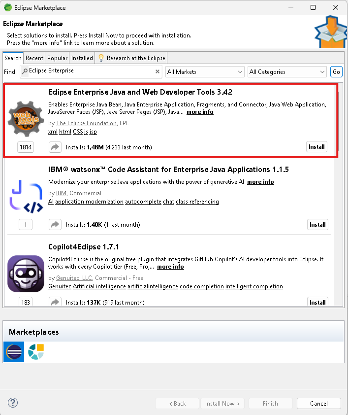
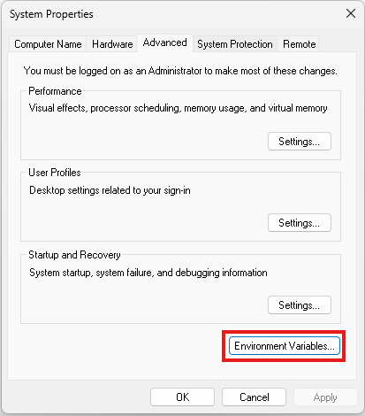
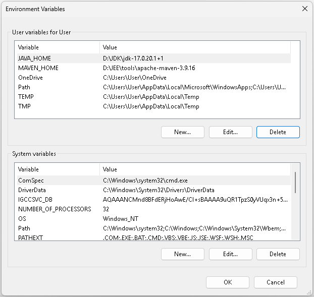

Developing Enterprise Java Applications - Environment Setup
===========================================================

This document offers a step-by-step guide to setup the development environment on Windows OS for building and executing the examples presented at _Developing Enterprise Java Applications_ course.

Software Requirements
---------------------

* [Java SE Development Kit 17+](https://adoptium.net/temurin/releases)
* [Apache Maven](https://maven.apache.org) 
* [Apache Tomcat 10.1+](https://tomcat.apache.org)
* [Spring Tool Suite for Eclipse](https://spring.io/tools)


Installing the Java SE Development Kit 17
-----------------------------------------
In order to install the Java SE Development Kit 17 follow the next steps:

1. Download the Java SE Development Kit 17 installer. The current version is [JDK 17.0.20.1](https://adoptium.net/temurin/releases?version=17&os=any&arch=any). The version you download may be newer.
2. Run the setup, accept the defaults and follow the screen instructions to install JDK and JRE.
3. Set the `JAVA_HOME` environment variable to `C:\Program Files\Eclipse Adoptium\jdk-17.0.20.101-hotspot` or location where you choose to install:
   
   ```bat
   set JAVA_HOME="C:\Program Files\Eclipse Adoptium\jdk-17.0.20.101-hotspot"
   ```
4. Update the `PATH` environment variable to include the location where Java executables are stored. In this case `C:\Program Files\Eclipse Adoptium\jdk-17.0.20.101-hotspot\bin`:
   
   ```bat
   set PATH="%PATH%;%JAVA_HOME%\bin"
   ```
   To set environment variables permanently see section [How to set an Environment Variable](#how-to-set-an-environment-variable).

You can check if JDK is correct installed opening a `Command Prompt Console` and running the following command: 
``` bat
C:\Users\Admin>java -version
openjdk version "17.0.20.1" 2026-08-18
OpenJDK Runtime Environment Temurin-17.0.20.1+1 (build 17.0.20.1+1)
OpenJDK 64-Bit Server VM Temurin-17.0.20.1+1 (build 17.0.20.1+1, mixed mode, sharing)
```

Installing the Apache Maven 
---------------------------
[Apache Maven](https://maven.apache.org/) is a build automation tool used primarily for Java projects.
In order to install the Apache Maven follow the next steps:

1. Download the [latest release](https://maven.apache.org/download.cgi),  for example  [apache-maven-3.9.16-bin.zip](https://dlcdn.apache.org/maven/maven-3/3.9.16/binaries/apache-maven-3.9.16-bin.zip). The version you download may be newer. 
2. Unpack the binary archive `apache-maven-3.9.16-bin.zip` to the folder you want to install, for example `D:\JEE\tools\apache-maven-3.9.16`.
3. Check if `JAVA_HOME` point to location where JDK is installed.
   
   ```bat
   C:\Users\Admin>echo %JAVA_HOME%
   C:\Program Files\Eclipse Adoptium\jdk-17.0.20.101-hotspot
   ```
4. Set the `MAVEN_HOME` environment variable to `D:\JEE\tools\apache-maven-3.9.16` (location where Maven is unpacked).
5. Update the `PATH` environment variable to include the folder where `mvn.cmd` is stored:
   
   ```bat
   set PATH=%PATH%;%MAVEN_HOME%\bin
   ```
   To set environment variables permanently see section [How to set an Environment Variable](#how-to-set-an-environment-variable).

You can check if Maven is correct installed opening a `Command Prompt Console` and running the following command: 
``` bat
C:\Users\Admin>mvn -version
Apache Maven 3.9.16 (2bdd9fddda4b155ebf8000e807eb73fd829a51d5)
Maven home: D:\JEE\tools\apache-maven-3.9.16
Java version: 17.0.20.1, vendor: Eclipse Adoptium, runtime: D:\JDK\jdk-17.0.20.1+1
Default locale: en_US, platform encoding: Cp1252
OS name: "windows 11", version: "10.0", arch: "amd64", family: "windows"
```

Installing the Apache Tomcat
----------------------------
[Apache Tomcat](http://tomcat.apache.org/), is an open-source Java Servlet Container developed by the Apache Software Foundation. Tomcat implements several Jakarta EE specifications including Java Servlet, JavaServer Pages (JSP), Java EL, and WebSocket.
In order to install the Apache Tomcat 10.1 follow the next steps:

1. Download the [latest release](https://tomcat.apache.org/download-10.cgi), for example [apache-tomcat-10.1.61.zip](https://dlcdn.apache.org/tomcat/tomcat-10/v10.1.61/bin/apache-tomcat-10.1.61.zip). The version you download may be newer like Tomcat 10.x. Please note that Tomcat 9.x is implements Java EE specifications that are not compatible with Jakarta EE specifications.
2. Unpack the binary archive `apache-tomcat-10.1.61.zip` to the folder you want to install, for example `D:\JEE\tools\apache-tomcat-10.1.61`
3. Review server settings (like server port, default value is 8080) in `D:\JEE\tools\apache-tomcat-10.1.60\conf\server.xml`
 
In order to start the server execute the following commands:
``` bat
cd /d D:\JEE\tools\apache-tomcat-10.1.61\bin
start.bat
```
In order to check installation in your favorite browser open the following link [http://localhost:8080](http://localhost:8080).


Installing the Spring Tool Suite for Eclipse
---------------------------------
The [Spring Tool Suite for Eclipse](https://spring.io/tools#eclipse) is an Eclipse-based development environment that is customized for developing Spring applications.
In order to install the Spring Tools Suite for Eclipse follow the next steps:

1. Download the _Spring Tool Suite for Eclipse_, for example [sspring-tools-for-eclipse-5.4.0.RELEASE-e4.41.0-win32.win32.x86_64.zip](https://cdn.spring.io/spring-tools/release/dist/5.4.0.RELEASE/e4.41/spring-tools-for-eclipse-5.4.0.RELEASE-e4.41.0-win32.win32.x86_64.zip)
2. Unpack the binary archive `spring-tools-for-eclipse-5.4.0.RELEASE-e4.41.0-win32.win32.x86_64.zip` to the folder you want to install, for example `D:\JEE\tools\sts-5.4.0.RELEASE`
3. Launch the application `SpringToolsForEclipse.exe` located in `D:\JEE\tools\sts-5.4.0.RELEASE\bin` and perform the following additional configurations to add installed Tomcat 10.1 in STS servers configuration:
   
   * Go to `Help` -> `Eclipse Marketplace` -> `Search` -> `Find`, type _Eclipse Enterprise_, Press `Go` and install [Eclipse Enterprise Java and Web Developer Tools](https://marketplace.eclipse.org/content/eclipse-enterprise-java-and-web-developer-tools) plugin:
      
      
     
   * Go to `Window` -> `Show View` -> `Other` -> `Server` -> `Servers`  
   * In the `Servers` panel click on `No servers available...` in order to add support for Tomcat 10.1 in STS
   * Select `Apache`->`Tomcat v10.1 server`
   * Select folder where Tomcat is unpacked, for example `D:\JEE\tools\apache-tomcat-10.1.60`   

How to set an Environment Variable
----------------------------------
1. Open `Start` on Windows 11. 
2. Search for `Edit the System Environment Variable` and click the top result to open the `System Properties` panel.
3. From `Advanced` tab click the `Environment Variables`
   
   

4. Click the `New` or `Edit` button under the `User variables for User` or the `System variables` in order to add or edit the variable.
   
   
   

References
---------------
1. [How to install Maven on Windows, Linux, Mac](https://www.baeldung.com/install-maven-on-windows-linux-mac)
2. [How to View and Manage Environment Variables in Windows](https://www.ninjaone.com/blog/how-to-view-and-manage-environment-variables/)

